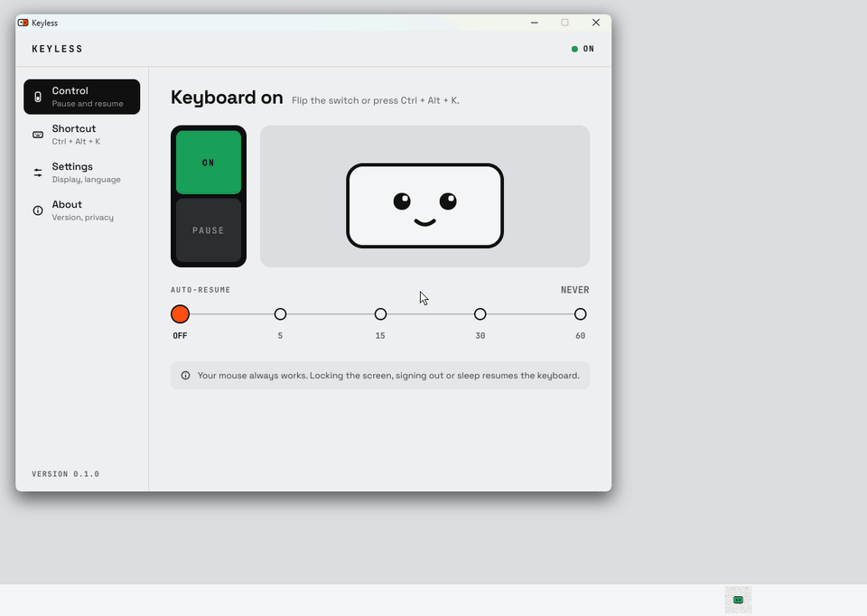

# Keyless

[](https://github.com/mrlahmar/keyless/releases) [](https://github.com/mrlahmar/keyless/releases) [](LICENSE)

Pause your keyboard so you can touch it without typing anything: rest your hands, lean
across it, put something on it, or clean it. Your mouse keeps working.

<picture>
  <source media="(prefers-color-scheme: dark)" srcset="docs/demo-dark.gif">
  
</picture>

## Why

I have a physical disability. To reach something on the far side of my desk, I often
have to rest my hand or arm on the keyboard, and it types whatever is under it. Keyless
lets me lean on the keyboard and keep using the mouse.

It also helps when:

- You want to wipe the keyboard without unplugging it or locking the PC.
- A small child keeps hitting keys while a cartoon plays or while they call family.
- A cat walks across the keyboard or decides to sleep on it.

## Install

Download the latest release from [Releases](https://github.com/mrlahmar/keyless/releases):

- `Keyless-Setup-x.y.z-x64.exe`: installer, no administrator rights needed
- `Keyless-x.y.z-x64-portable.zip`: a single `keyless.exe`, nothing to install

Windows 10 (1809) or later, x64. macOS and Linux are planned.

Keyless isn't code-signed yet, so Windows may show "Windows protected your PC" the first
time. Click **More info**, then **Run anyway**.

In English, 中文, हिन्दी, Español, العربية, Français, বাংলা, Português, Русский and Bahasa
Indonesia. Keyless follows the Windows language; change it in Settings.

## Use

- Click the tray icon and flip the switch to **PAUSE**. Or press **Ctrl + Alt + K** anywhere.
- While paused, click **Resume** on the paused tag or flip the switch back, or press the
  shortcut. Drag the tag anywhere; Keyless remembers the spot.
- Options: change the shortcut by typing it or by clicking keys with the mouse, stop the
  shortcut from resuming (so resting hands can't resume by accident), auto-resume after
  a few minutes, where the paused tag appears, start at sign-in, light or dark.

Keyless resumes on its own when you lock the screen, sign out or the PC sleeps, and it
always starts with the keyboard on.

## Privacy

Keyless reads key events only to decide whether to block them. It never records, stores
or sends keystrokes, and it makes no network connections. See [SECURITY.md](SECURITY.md).

## Limits

Keyless is a comfort tool, not a security lock. Ctrl + Alt + Delete and Windows security
screens always work. Input from on-screen keyboards, voice typing and other software
is not blocked. Apps running as administrator may still receive keys unless Keyless also
runs as administrator.

## Build

Requires Rust (stable). On Windows:

```sh
cargo run              # debug build
cargo test --workspace
cargo build --release  # target/release/keyless.exe
```

To build the installer locally, install [Inno Setup 6](https://jrsoftware.org/isinfo.php) and run
`scripts/package.ps1`. See [CONTRIBUTING.md](CONTRIBUTING.md) and [docs/ARCHITECTURE.md](docs/ARCHITECTURE.md).

## License

Keyless is [MIT licensed](LICENSE).
